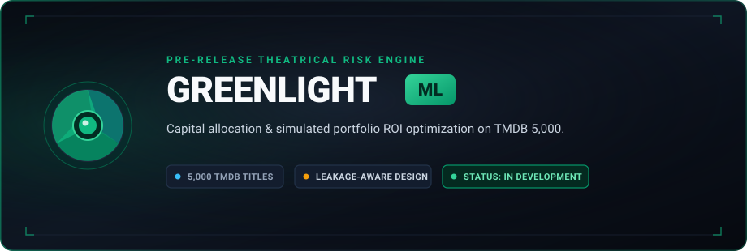
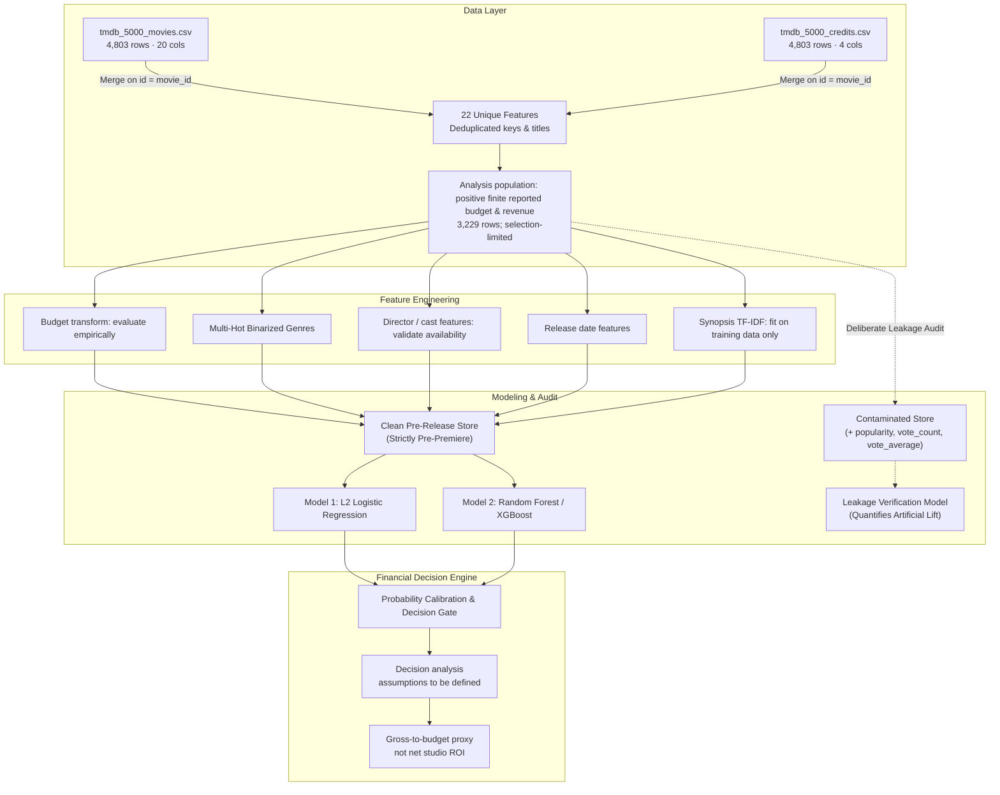

<p align="center">
  
</p>

<h1 align="center">greenlight-ml</h1>

<p align="center"><em>To greenlight or to shelve.</em><br />
Pre-release film modeling research with explicit data-selection, feature-timing, and evaluation audits.</p>

<p align="center">
  <a href="#quickstart"><strong>Quickstart</strong></a>
  &nbsp;·&nbsp;
  <a href="#roadmap"><strong>Roadmap</strong></a>
  &nbsp;·&nbsp;
  <a href="./docs/DATA_DICTIONARY.md"><strong>Data Schema</strong></a>
  &nbsp;·&nbsp;
  <a href="./docs/METHODOLOGY.md"><strong>Methodology</strong></a>
  &nbsp;·&nbsp;
  <a href="./docs/METRICS_AND_ROI.md"><strong>Financial Proxy</strong></a>
  &nbsp;·&nbsp;
  <a href="./docs/EDA_REPORT.md"><strong>EDA Report</strong></a>
  &nbsp;·&nbsp;
  <a href="#evaluation-status"><strong>Evaluation</strong></a>
  &nbsp;·&nbsp;
  <a href="#architecture"><strong>Pipeline</strong></a>
</p>

<p align="center">
  <a href="./LICENSE"></a>
  
  
  
  
</p>

---

In theatrical distribution, **"greenlighting"**—the studio executive commitment to finance and market a feature film—is among the highest-variance capital allocation decisions in business. As legendary screenwriter William Goldman observed: *"Nobody knows anything."* Multi-hundred-million-dollar commitments are routinely made on historical pedigree, star packaging, and subjective instinct.

**greenlight-ml** is a research project exploring pre-release film outcome modeling. The current work is focused on defining the reported-financials population, auditing feature timing, and establishing a defensible evaluation protocol before making performance or investment claims.

---

## ⚡ Quickstart

### 1. Clone & Set Up

```bash
git clone git@github.com:andreisugu/greenlight-ml.git
cd greenlight-ml

# Setup environment with uv (instant) or pip
uv venv && source .venv/bin/activate
uv pip install -r requirements.txt
```

### 2. Fetch the data and run the EDA

```bash
# Downloads the two CSV files into the git-ignored data/ directory
python scripts/download_data.py

# Open the audited EDA notebook
jupyter lab notebooks/01_exploratory_data_analysis.ipynb
```

The model benchmark is currently a development scaffold, not a validated result; see [methodology](./docs/METHODOLOGY.md).

### 3. Verify the data contracts

```bash
python -m unittest discover -s tests -v
```

---

## 🔬 The Three Audits

This project investigates three risks that can make film-prediction results misleading. The figures below describe the local TMDB sample; they are not universal claims about published research:

| | The Assumption | What the Data Actually Proves |
|---|---|---|
| **1. Financial-reporting selection** | *"The rows with unknown financials are failures."* | In this dump, **1,574 / 4,803** rows have a zero budget or revenue; those values do not reveal why they are absent. Among the **3,229** rows with positive reported finances, **2,438 (75.50%)** have revenue greater than production budget. This is a selected-sample class prevalence, not an industry-wide success rate. |
| **2. Gross multiple is not net profit** | *"Revenue > budget means the studio made money."* | The files contain gross revenue and production budget, not exhibitor settlements or marketing/distribution costs. The descriptive label `revenue >= 2 × budget` occurs for **1,809 / 3,229 (56.02%)** reported-financial rows. It is a rough alternative proxy, not verified profitability. |
| **3. Feature-time leakage** | *"A column in the CSV was available before release."* | The file is a later metadata snapshot. Reception fields such as `popularity`, `vote_average`, and `vote_count` are leakage candidates for a pre-release decision. Their correlations do not prove the timestamp; a leakage experiment and its scores are **not yet validated**. |

### Stage-1 receipts beyond these three risks

The executed EDA adds four findings that shape the modeling contract: **19 genre labels** and **27 languages**
(English covers 96.1%) with two rare genres (`Documentary` 38, `Foreign` 5); **628 directors** and **1,425 lead actors**
recur across retained titles, so the rows are *not* independent; the standardised numeric block collapses to **72.7%**
variance on two principal components with heavy class overlap; and the proxy rate is **non-stationary** (**91.6%** before
1980 vs **74.1%** from 2000) while the median reported budget grows from **$0.4M to $30M**. Every figure is reproduced in
[`docs/EDA_REPORT.md`](./docs/EDA_REPORT.md) and the [EDA notebook](./notebooks/01_exploratory_data_analysis.ipynb).

---

## 🗺️ Project Roadmap & Current Status

* [x] **Phase 1: Architecture, Scaffolding & Data Dictionary** — Core repository layout, TMDB 5000 deduplication audit, methodology definition, and feature engineering skeleton.
* [x] **Phase 2: Exploratory Data Analysis & Schema Audits** — Primary population is 3,229 rows with positive finite reported finances; the >$10K rule is sensitivity-only. A contract-tested merge, reconciled exclusions, distributions, category cardinality, entity repetition, PCA structure, and temporal-regime stability are all documented. See [`notebooks/01_exploratory_data_analysis.ipynb`](./notebooks/01_exploratory_data_analysis.ipynb) and [`docs/EDA_REPORT.md`](./docs/EDA_REPORT.md).
* [ ] **Phase 3: Regularized Linear Baseline Modeling** — Logistic Regression with cross-validated penalty sweeps ($C$, solvers) vs. Naive Majority baseline ([`notebooks/02_baseline_linear_model.ipynb`](./notebooks/02_baseline_linear_model.ipynb)).
* [ ] **Phase 4: Nonlinear Ensemble Modeling & NLP** — Overview synopsis TF-IDF embeddings, director/lead cast frequency encoding, and XGBoost/Random Forest tuning ([`notebooks/03_advanced_ensemble_model.ipynb`](./notebooks/03_advanced_ensemble_model.ipynb)).
* [ ] **Phase 5: Leakage & Financial Proxy Analysis** — Controlled post-release leakage experiment and explicitly limited gross-to-budget proxy analysis ([`notebooks/04_leakage_audit_and_roi.ipynb`](./notebooks/04_leakage_audit_and_roi.ipynb)).

---

## 📊 Evaluation Status

> **No validated model-performance or portfolio results are published yet.** Receipts are withheld pending a frozen target/decision contract. The earlier benchmark fit TF-IDF/category representations before the split and used a disputed >$10K population restriction; that preprocessing bug is now fixed (`src/features.py` `FeatureEncoder` + split-before-fit in `scripts/benchmark.py`), but the target proxy and population are still not frozen. Do not cite any score as generalization evidence.

The first modeling stage must establish a transparent baseline on the same locked split as subsequent models. Metrics will be published only after the target limit is fixed and preprocessing is confirmed to be fitted within training folds only. The current model notebooks remain drafts.

---

## 🏗️ Planned Architecture (Not Yet Validated)



---

## 📦 Dataset & Schema Audit

The underlying data originates from [The Movie Database (TMDB)](https://www.themoviedb.org) via Kaggle. Merging `movies` and `credits` on `id = movie_id` yields **22 unique features** (not 24, as `movie_id` and `title` are redundant duplicates):

* **Target proxies:** `revenue > budget` and `revenue >= 2 * budget`; neither is verified studio net profit.
* **Primary EDA population:** 3,229 rows with positive finite budget and revenue. This is conditional on financial reporting, not the full universe of films.
* **Pre-release candidates:** budget, genres, runtime, release date, language, credits and overview. Their historical availability at the intended prediction date still requires provenance checks.
* **Leakage candidates:** `popularity`, `vote_average`, and `vote_count`; keep out of the pre-release model unless feature-time evidence proves otherwise.
* **Scale sensitivity:** a strict >$10K floor removes 26 rows, including 16 nominal gross-at/below-budget rows and 10 above-budget. It is a population restriction, not evidence that all 26 records are corrupt.

---

## 🛠️ Repository Structure

```text
greenlight-ml/
├── docs/                      # Technical documentation & deep-dive audits
│   ├── DATA_DICTIONARY.md     # 22 unique features, relational merge, population & sensitivity audit
│   ├── METHODOLOGY.md         # Population definition, selection limits, leakage-safe evaluation protocol
│   ├── METRICS_AND_ROI.md     # Metric definitions and financial-proxy limitations
│   └── EDA_REPORT.md          # Written Stage-1 EDA report: question → method → finding → decision
├── notebooks/                 # Interactive Jupyter notebooks for research & reproduction
│   ├── 01_exploratory_data_analysis.ipynb
│   ├── 02_baseline_linear_model.ipynb
│   ├── 03_advanced_ensemble_model.ipynb
│   └── 04_leakage_audit_and_roi.ipynb
├── src/                       # Production-grade modular Python package
│   ├── data.py                # File validation, relational merge & population definitions
│   ├── features.py            # Feature pipeline (TF-IDF, multi-hot, JSON parsing) — train-fit only
│   ├── models.py              # Model factory & GridSearchCV parameter spaces
│   └── metrics.py             # Classification metrics and gross-to-budget proxy
├── scripts/
│   ├── download_data.py       # Kaggle dataset fetcher via kagglehub
│   └── benchmark.py           # Experimental scaffold (not valid evidence yet)
├── tests/                     # Data-contract & metric unit tests
├── assets/
│   └── banner.svg             # Dark-mode cinema aperture vector banner
├── .gitignore                 # Strict data & private cache ignore rules
├── LICENSE                    # Apache 2.0 open-source license
├── README.md                  # Project overview & current evidence status
└── requirements.txt           # Production dependencies
```

---

## 📄 License

Distributed under the **Apache License 2.0**. See [`LICENSE`](LICENSE) for details.
