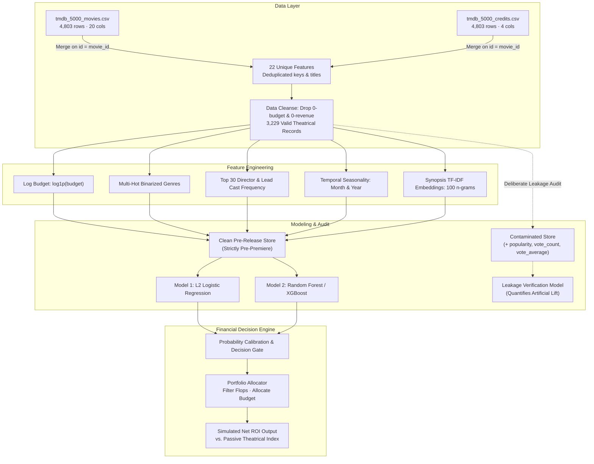

<p align="center">
  
</p>

<h1 align="center">greenlight-ml</h1>

<p align="center"><em>To greenlight or to shelve.</em><br />
Pre-release commercial film success modeling, simulated portfolio ROI optimization, and systematic audit of entertainment data leakage.</p>

<p align="center">
  <a href="#quickstart"><strong>Quickstart</strong></a>
  &nbsp;·&nbsp;
  <a href="#roadmap"><strong>Roadmap</strong></a>
  &nbsp;·&nbsp;
  <a href="./docs/DATA_DICTIONARY.md"><strong>Data Schema</strong></a>
  &nbsp;·&nbsp;
  <a href="./docs/METHODOLOGY.md"><strong>Methodology</strong></a>
  &nbsp;·&nbsp;
  <a href="./docs/METRICS_AND_ROI.md"><strong>Financial ROI</strong></a>
  &nbsp;·&nbsp;
  <a href="#evaluation-framework"><strong>Baseline</strong></a>
  &nbsp;·&nbsp;
  <a href="#architecture"><strong>Pipeline</strong></a>
</p>

<p align="center">
  <a href="./LICENSE"></a>
  
  
  
  
</p>

---

In theatrical distribution, **"greenlighting"**—the studio executive commitment to finance and market a feature film—is among the highest-variance capital allocation decisions in business. As legendary screenwriter William Goldman observed: *"Nobody knows anything."* Multi-hundred-million-dollar commitments are routinely made on historical pedigree, star packaging, and subjective instinct.

**greenlight-ml** is an applied machine learning and natural language processing engine designed to model theatrical commercial viability **strictly prior to release**. Rather than reporting hollow accuracy scores on dirty data, greenlight-ml treats entertainment analytics with radical methodological rigor: measuring capital allocation efficiency (simulated portfolio ROI), dismantling survivorship bias, and auditing the silent data leaks that invalidate academic film modeling.

---

## ⚡ Quickstart

### 1. Clone & Set Up

```bash
git clone git@github.com:andreisugu/greenlight-ml.git
cd greenlight-ml

# Setup environment with uv (instant) or pip
uv venv && source .venv/bin/activate
uv pip install -r requirements.txt
```

### 2. Fetch TMDB 5000 & Run the Verified Benchmark

```bash
# Downloads and extracts tmdb_5000_movies.csv and tmdb_5000_credits.csv
python scripts/download_data.py

# Runs the complete pre-release pipeline vs leakage benchmark
python scripts/benchmark.py
```

---

## 🔬 The Three Audits

Most published film prediction papers claim ~80% accuracy. Almost all of them are structurally invalid. Here is why:

| | The Assumption | What the Data Actually Proves |
|---|---|---|
| **1. The Survivorship Trap**<br />*Selection bias in public datasets* | *"80% accuracy means our model is strong."* | In TMDB 5000, 1,574 films (32.8%) lack budget or revenue and get pruned. The remaining 3,229 commercially reported films are overwhelmingly hits: **75.50% grossed more than their nominal budget**. A dumb baseline predicting "Success" for every film gets **75.54% Accuracy** and **0.86 F1** out of the box. Any pre-release model scoring 75% is barely matching a coin toss weighted to the house. |
| **2. The Hollywood Multiplier**<br />*Nominal profit vs studio break-even* | *"If $Revenue > Budget$, the film was profitable."* | Box office gross is split ~50/50 with cinema exhibitors, and production budgets omit global Print & Advertising (P&A), which frequently matches the production budget. Industry consensus places real profitability at:$$\text{Gross Revenue} \ge 2.0 \times \text{Production Budget}$$At $2.0\times$, the class distribution rebalances naturally to **55.87% success vs. 44.13% loss**, exposing genuine model discrimination. |
| **3. The Silent Data Leak**<br />*Post-release contamination* | *"Popularity and user votes are just features."* | TMDB `popularity`, `vote_average`, and `vote_count` are recalculated daily **post-release** based on current user searches, watchlist additions, and retrospective ratings. `popularity` alone has a **0.60 correlation** with revenue. Allowing post-release signals inflates ROC-AUC from 0.61 to 0.83—creating an illusion of predictive power useless for greenlighting. |

---

## 🗺️ Project Roadmap & Current Status

* [x] **Phase 1: Architecture, Scaffolding & Data Dictionary** — Core repository layout, TMDB 5000 deduplication audit, methodology definition, and feature engineering skeleton.
* [x] **Phase 2: Exploratory Data Analysis & Schema Audits** *(Current)* — Systematic distribution modeling, outlier pruning (26 scale anomalies), and correlation heatmaps ([`notebooks/01_exploratory_data_analysis.ipynb`](./notebooks/01_exploratory_data_analysis.ipynb)).
* [ ] **Phase 3: Regularized Linear Baseline Modeling** — Logistic Regression with cross-validated penalty sweeps ($C$, solvers) vs. Naive Majority baseline ([`notebooks/02_baseline_linear_model.ipynb`](./notebooks/02_baseline_linear_model.ipynb)).
* [ ] **Phase 4: Nonlinear Ensemble Modeling & NLP** — Overview synopsis TF-IDF embeddings, director/lead cast frequency encoding, and XGBoost/Random Forest tuning ([`notebooks/03_advanced_ensemble_model.ipynb`](./notebooks/03_advanced_ensemble_model.ipynb)).
* [ ] **Phase 5: Leakage Auditing & Portfolio Simulation** — Controlled post-release leakage experiments, Hollywood 2.0x break-even evaluation, and simulated net portfolio ROI allocator ([`notebooks/04_leakage_audit_and_roi.ipynb`](./notebooks/04_leakage_audit_and_roi.ipynb)).

---

## 📊 Evaluation Framework & Baseline Simulation

> ℹ️ **Scaffolding Baseline Note:** The metrics below represent the preliminary proof-of-concept simulation generated during project setup (`scripts/benchmark.py`) to validate pipeline interfaces, test holdout splits, and establish reference targets. All receipts run on the **canonical 3,203-title modeling set** (post scale-anomaly prune, see the [EDA notebook](./notebooks/01_exploratory_data_analysis.ipynb)). Model training, hyperparameter sweeps, and ablation studies are actively conducted in the respective notebooks.

Evaluated on an 80/20 stratified holdout split (641 unseen titles, random seed 42):

| Model / Strategy | Information Scope | Accuracy | Precision | Recall | F1 Score | ROC-AUC | Net Portfolio ROI | Titles Picked |
|---|:---:|:---:|:---:|:---:|:---:|:---:|:---:|:---:|
| **Market Index Benchmark** | *Passive (Fund all)* | 0.7582 | 0.7582 | **1.0000** | 0.8625 | 0.5000 | +180.70% | 641 / 641 |
| **Logistic Regression** | **Pre-release only** | 0.7457 | **0.7687** | 0.9506 | 0.8500 | **0.6206** | **+184.98%** | 601 / 641 |
| **Random Forest (100 est.)** | **Pre-release only** | 0.7457 | 0.7626 | 0.9650 | 0.8520 | 0.5992 | +181.72% | 615 / 641 |
| **Logistic Regression (LEAKED)** | *Post-release ⚠️* | 0.7863 | 0.8497 | 0.8724 | 0.8609 | 0.8114 | +212.98% | 499 / 641 |
| **Random Forest (LEAKED)** | *Post-release ⚠️* | **0.8066** | 0.8415 | 0.9177 | **0.8780** | **0.8250** | +207.31% | 530 / 641 |

### Financial Evaluation Metric

Accuracy measures classification; **Net Portfolio ROI** measures whether you keep your fund:

$$\text{Net Portfolio ROI} = \frac{\sum_{i \in \text{Selected}} (\text{Revenue}_i - \text{Budget}_i)}{\sum_{i \in \text{Selected}} \text{Budget}_i}$$

> **Key Finding:** Pre-release signals alone struggle to surpass the naive accuracy baseline due to high creative variance. However, a regularized pre-release model acts as an intelligent capital filter: by rejecting 40 high-probability flops, it boosts simulated fund ROI from **+180.70% to +184.98%** on the holdout portfolio.

---

## 🏗️ Architecture



---

## 📦 Dataset & Schema Audit

The underlying data originates from [The Movie Database (TMDB)](https://www.themoviedb.org) via Kaggle. Merging `movies` and `credits` on `id = movie_id` yields **22 unique features** (not 24, as `movie_id` and `title` are redundant duplicates):

* **Financial Target:** `revenue` (Worldwide gross box office).
* **Pre-release Inputs:** `budget`, `genres` (JSON), `runtime`, `release_date`, `original_language`, `production_countries`, `production_companies`, `cast` (lead billing), `crew` (director extraction), `overview` (synopsis text).
* **Post-release Leaks (Isolated):** `popularity` (daily traffic/watchlist index), `vote_average` (0–10 score), `vote_count` (review volume).
* **Sanity Pruning:** Detects unit scale corruptions (e.g., Hollywood features entered with unscaled budgets like \$30 or \$10 instead of \$30M, and Charlie Chaplin's *Modern Times* entered with \$1 budget).

---

## 🛠️ Repository Structure

```text
greenlight-ml/
├── docs/                      # Technical documentation & deep-dive audits
│   ├── DATA_DICTIONARY.md     # 22 unique features, relational merge, unit scale audit
│   ├── METHODOLOGY.md         # Survivorship bias, Hollywood 2.0x break-even, leakage isolation
│   └── METRICS_AND_ROI.md     # Portfolio ROI formulation, capital efficiency & alpha
├── notebooks/                 # Interactive Jupyter notebooks for research & reproduction
│   ├── 01_exploratory_data_analysis.ipynb
│   ├── 02_baseline_linear_model.ipynb
│   ├── 03_advanced_ensemble_model.ipynb
│   └── 04_leakage_audit_and_roi.ipynb
├── src/                       # Production-grade modular Python package
│   ├── data.py                # Data ingestion, schema validation & pruning
│   ├── features.py            # Multimodal feature pipeline (TF-IDF, Multi-Hot, JSON parsing)
│   ├── models.py              # Model factory & systematic GridSearchCV parameter spaces
│   └── metrics.py             # Balanced accuracy, Macro F1, and Net Portfolio ROI
├── scripts/
│   ├── download_data.py       # Kaggle dataset fetcher via kagglehub
│   └── benchmark.py           # Reproducible benchmark runner & metrics printer
├── assets/
│   └── banner.svg             # Dark-mode cinema aperture vector banner
├── .gitignore                 # Strict data & private cache ignore rules
├── LICENSE                    # Apache 2.0 open-source license
├── README.md                  # Project overview & benchmark receipts
└── requirements.txt           # Production dependencies
```

---

## 📄 License

Distributed under the **Apache License 2.0**. See [`LICENSE`](LICENSE) for details.
