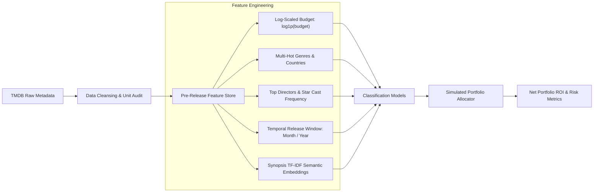

# GreenlightML 🎬💰

> **Pre-release commercial success prediction and simulated portfolio ROI optimization engine for theatrical films using TMDB metadata and NLP.**

[](https://www.python.org/downloads/)
[](https://opensource.org/licenses/Apache-2.0)
[](https://www.kaggle.com/datasets/tmdb/tmdb-movie-metadata)
[](https://github.com/psf/black)

---

## 📌 Overview

In the film entertainment industry, **"greenlighting"**—the formal studio executive decision to finance and commit a project into production—is among the highest-stakes economic gambles in business. As legendary screenwriter William Goldman famously observed: *"Nobody knows anything."* Hundreds of millions of dollars are frequently committed based on intuition, past star power, or subjective packaging.

**GreenlightML** is an applied machine learning and natural language processing (NLP) framework designed to model commercial success **strictly prior to theatrical release**. Beyond baseline classification, this project establishes a realistic simulated portfolio investment strategy (ROI optimization) and exposes critical methodological pitfalls in entertainment analytics: **survivorship bias**, **data leakage**, and the difference between nominal break-even and Hollywood's true economic multiplier.

---

## 🔬 Core Insights & Methodological Audit

### 1. The Survivorship Bias & Class Imbalance (75.5% vs 24.5%)
* In raw TMDB 5000 data, 1,574 out of 4,803 films (32.8%) report zero budget or zero box office gross.
* Pruning missing records leaves **3,229 clean films**. However, commercially reported titles heavily skew toward box office successes: **75.50% (2,438 films)** gross more than their nominal budget.
* **The Metric Trap:** A naive dummy classifier predicting *"Success"* for every test title trivially scores **75.54% Accuracy** and **0.86 F1**. Evaluating pre-release models purely on raw accuracy or positive F1 is structurally deceptive.

### 2. The Hollywood Break-Even Rule ($2.0\times$ Multiplier)
* In film economics, gross box office receipts are split ~50/50 with exhibitors (theater owners).
* Production budgets do **not** include Print & Advertising (P&A), which routinely equals or exceeds the production budget.
* The real-world industry benchmark for financial profitability is:
  $$\text{Box Office Revenue} \ge 2.0 \times \text{Production Budget}$$
* Under the $2.0\times$ rule, the class distribution naturally rebalances to **55.87% success vs. 44.13% loss**, providing a grounded evaluation benchmark.

### 3. Data Leakage Anatomy
* TMDB computes `popularity`, `vote_average`, and `vote_count` dynamically **post-release** based on ongoing search traffic, user reviews, and watchlist additions.
* `popularity` exhibits a **0.60 correlation** with revenue. Including it produces a massive artificial performance boost (jumping from 0.61 to 0.83 ROC-AUC), invalidating pre-production decision-making. GreenlightML strictly isolates these signals into a comparative leakage benchmark.

---

## 📊 Experimental Results

Evaluated on an 80/20 stratified test split (646 unseen titles):

| Model / Scenario | Data Scope | Accuracy | Precision | Recall | F1 Score | ROC-AUC | Net Portfolio ROI |
| :--- | :---: | :---: | :---: | :---: | :---: | :---: | :---: |
| **Market Index Benchmark (Invest in all)** | Passive | 0.7554 | 0.7554 | 1.0000 | 0.8607 | 0.5000 | **+177.76%** |
| **Logistic Regression (L2 regularized)** | Pre-release | 0.7430 | 0.7657 | 0.9508 | 0.8483 | 0.6209 | **+181.76%** |
| **Random Forest (100 estimators)** | Pre-release | 0.7523 | 0.7628 | 0.9754 | 0.8561 | 0.6101 | **+179.65%** |
| **Logistic Regression (LEAKED: pop/votes)** | Post-release ⚠️ | **0.8050** | **0.8591** | 0.8873 | **0.8730** | **0.8139** | **+207.13%** |
| **Random Forest (LEAKED: pop/votes)** | Post-release ⚠️ | **0.8111** | **0.8427** | 0.9221 | **0.8806** | **0.8343** | **+202.04%** |

$$\text{Net Portfolio ROI} = \frac{\sum_{i \in \text{Selected}} (\text{Revenue}_i - \text{Budget}_i)}{\sum_{i \in \text{Selected}} \text{Budget}_i}$$

> **Key Finding:** Pre-release signals alone struggle to surpass the naive accuracy baseline due to high intrinsic variance in creative reception, yet model-driven selection achieves superior capital efficiency (+181.76% ROI vs +177.76% passive market portfolio).

---

## 🏗️ Feature Pipeline Architecture



---

## 🚀 Quickstart

### Prerequisites
* Python 3.10+
* [`uv`](https://github.com/astral-sh/uv) (recommended) or `pip`

### Setup

```bash
# Clone the repository
git clone git@github.com:andreisugu/greenlight-ml.git
cd greenlight-ml

# Install dependencies with uv
uv venv
source .venv/bin/activate
uv pip install -r requirements.txt
```

---

## 📄 License

Distributed under the Apache License 2.0. See [`LICENSE`](LICENSE) for more information.
